# Création d'un VST

[Voir la vidéo YouTube](https://www.youtube.com/watch?v=Z91QfRdT5EI)

## 1. Création du sujet

Ouvrir l’acquisition Static

Dans le panneau **Resources**, onglet **Subjects**, sélectionner **Create a blank subject**. Entrer le nom du futur Template (*Pour les projets validés CPP, entrer le nom de l'étude*).

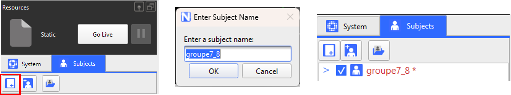

**Attention, toujours travailler sur la même frame !!!**

## 2. Création des segments

Dans le panneau **Tools**, onglet **Subject Preparation** 
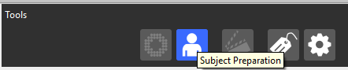

Dans **Labeling Template Builder** créer les segments (pelvis, femurD, tibiaD, piedD, femurG, tibiaG, piedG).

Commencer par le pelvis

*Il est plus simple de se placer face au sujet*

1. Indiquer le nom et cliquer sur create
    <figure>
    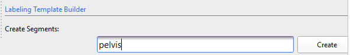
    </figure>

2. Sélectionner le marqueur origine du segment

3. Sélectionner les autres marqueurs pour former :
    - L’axe principal (*plus longue distance depuis l’origine*)
    - L’axe secondaire (*direction différente que marqueur précédent*)
    - Le marqueur additionnel (*autre direction*)

4. Recliquer sur create et le segment est terminé (*Le cube correspond à l'origine du segment*)
    <figure>
    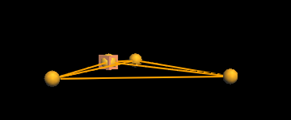
    </figure>

5. Dans l’onglet <strong>Subjects</strong>, étendre le menu déroulant, les marqueurs et le segment créé apparaissent. 
    <figure>
    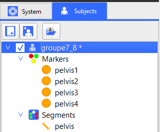
    </figure>

Faire de même pour les autres segments. Il est préférable d’avoir un marqueur commun à chaque segment. 

## 3. Renommer les marqueurs

Une fois le modèle terminé, nommer les marqueurs selon le marqueur set défini. *Noms à adapter si le markerset est différent.*

<figure>
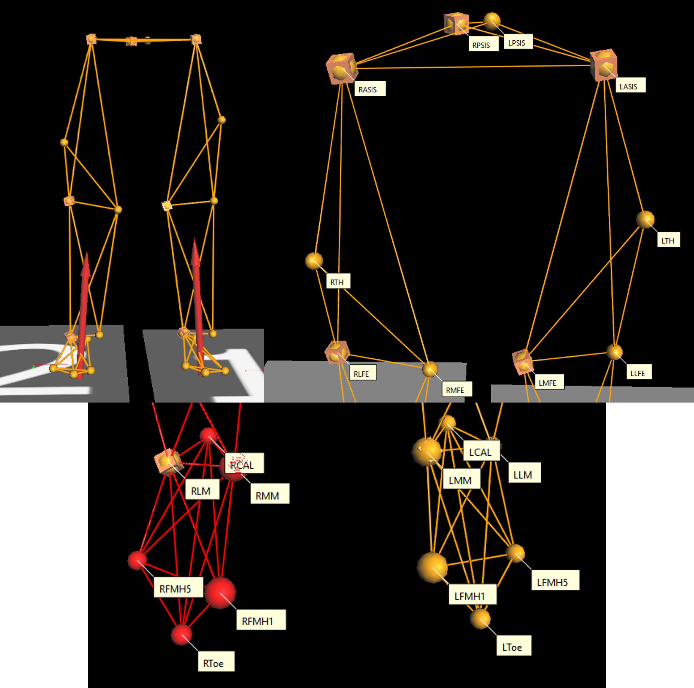
</figure>

Pour différencier le côté droit et gauche, changer la couleur des marqueurs (CTRL + clic gauche pour sélectionner les marqueurs). Cliquer sur **Color** et modifier la couleur. Changer le radius des marqueurs médiaux (RMFE, LMFE, RMM, LMM, RFMH1, LFMH1).

<figure>
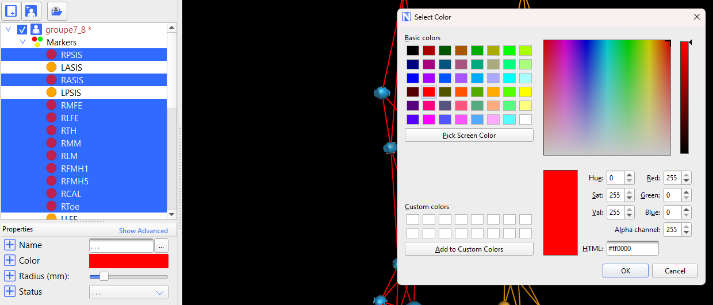
</figure>

Si certains marqueurs ne sont présents que pendant la statique les indiquer comme « optional » ou « calibration only »
<figure>
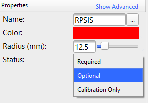
</figure>

## 4. Relier les segments

Dans **Link segments**, définir le type d’articulation (*e.g.,* ball joint) et cliquer sur **Link** pour relier les segments (**du proximal vers le distal**). 

1. Choisir le segment parent (pelvis)
    <figure>
    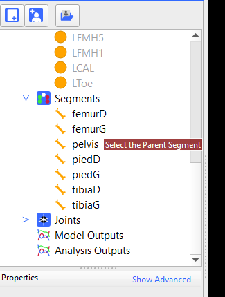
    </figure>

2. Choisir le segment enfant. Pelvis → femurD → tibiaD → piedD. *Faire la même chose pour le côté gauche*
    <figure>
    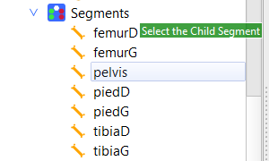
    </figure>

3. Une fois l’opération terminée, les articulations apparaissent
    <figure>
    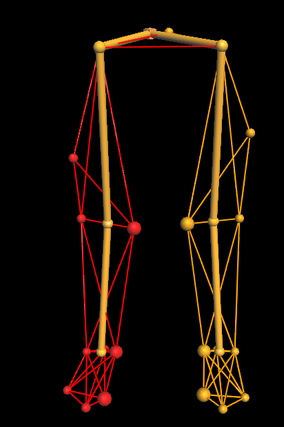
    </figure>

Le modèle est fini, à cette étape le nom du modèle doit apparaitre en **noir**. S’il est **rouge**, une étape est manquante ou erreur est apparue. Il est préférable de recommencer de zéro.

## 5. Finalisation du VST

Onglet **Tools** > **pipeline** > **Current pipeline**, sélectionner **Calibrate Labeling skeleton static** 
<figure>
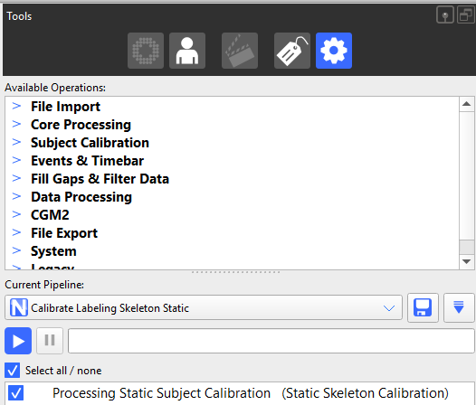
</figure>

Dans le menu déroulant **available operation** > **subject calibration**, double cliquer sur **Set autolabel pose** et update **skeleton parameters**. Tout apparait dans le Current pipeline, et cliquer sur play.
<figure>
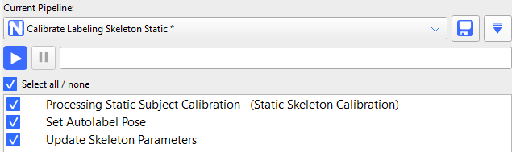
</figure>

*Si une calibration fonctionnelle est réalisée, faire la même chose en sélectionnant **create labelling skeleton ROM** à la place, et ajouter set autolabel pose et update skeleton parameters.*

Sauvegarder le sujet comme template : clic droit sur le sujet et **Save labelling skeleton as template**.