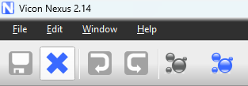
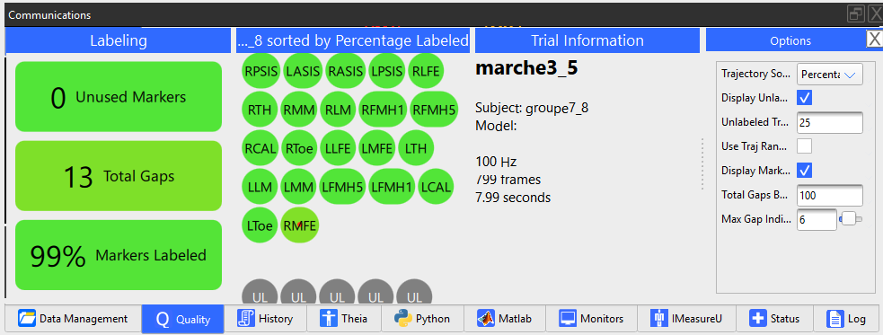
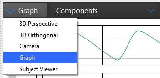
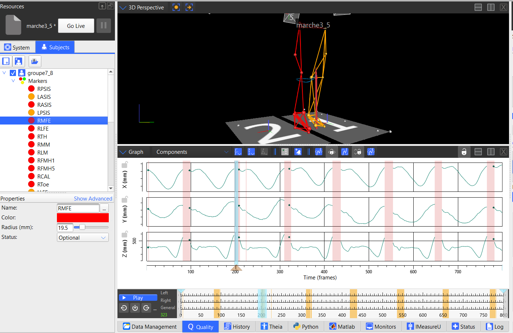
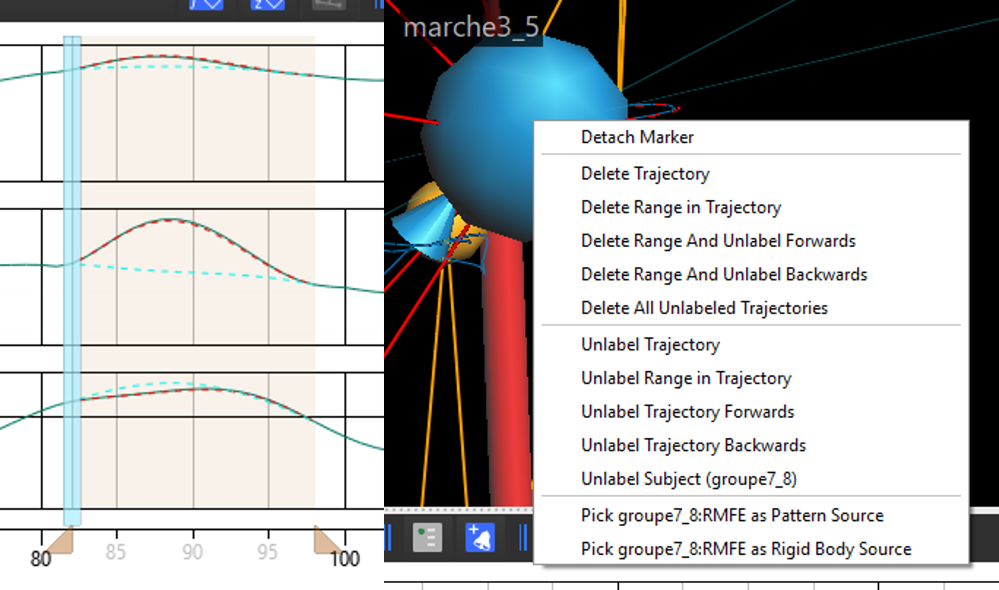
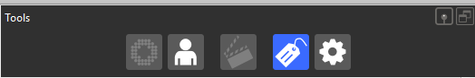
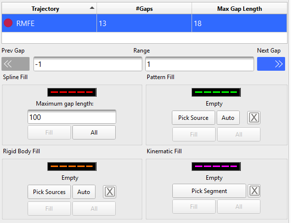
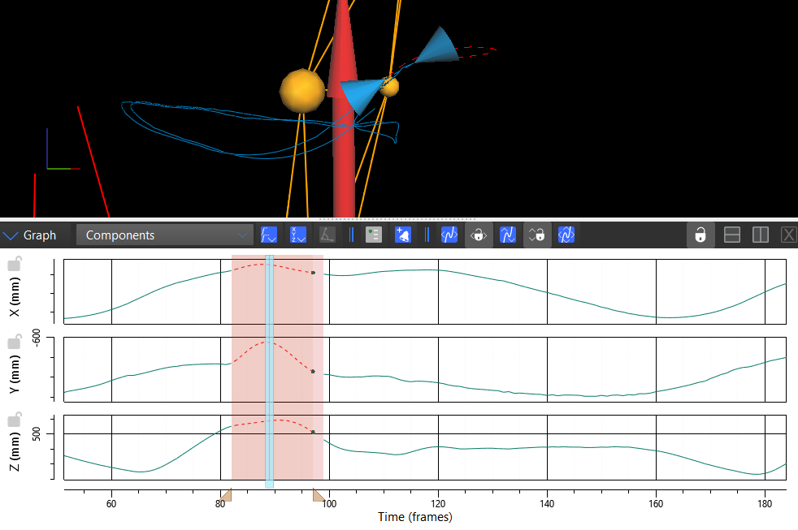
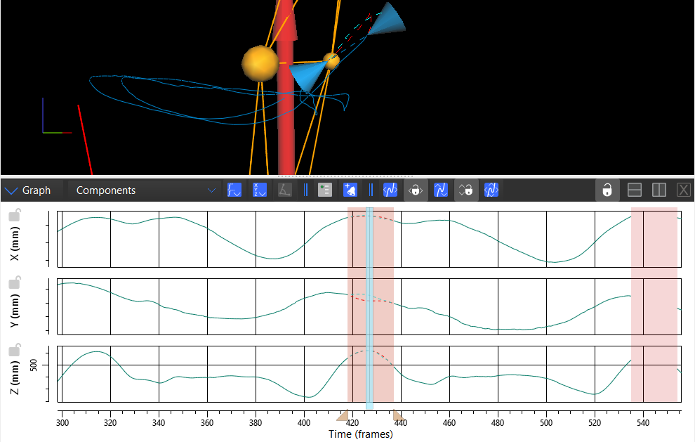

# Traitement des acquisitions dynamiques

Ouvrir marche3_5 (ou n'importe quel enregistrement dynamique)

**Le modèle du sujet doit avoir été effectué au préalable**

- Il n'y a pas de modèle (c'est le premier sujet de l'étude), voir [Création d'un VST](nouveau_VST.md)

- Il y a un modèle mais je n'ai pas traité la statique, voir [Utilisation d'un VST pour un nouveau sujet](utiliser_VST.md)

## 1. Faire apparaitre et labelliser les marqueurs

Cliquer sur **reconstruct and label** (boules bleues).
<figure>

</figure>

## 2. Qualité des données et bouchage des trous

Onglet **Quality**, on peut voir la qualité, marqueurs labelisés, les trous, … Survoler les bulles des marqueurs pour afficher les pourcentages de labellisation. 
<figure>

</figure>

Afficher le graphique des marqueurs. Vérifier qu’il n’y a pas de pic absurde, bruit, … et identifier les marqueurs avec des trous.
<figure>

</figure>

Clic droit + faire glisser la souris vers la droite pour zoomer sur le graphique. Utiliser les icones pour choisir les axes à afficher, et ajuster les axes en automatique. 
<figure>

</figure>

S’il y a un pic absurde, sélectionner la zone à effacer en déplaçant la barre bleue et les curseurs orange. Clic droit sur le marqueur et **delete range in trajectory**. 
<figure>

</figure>

Dans **Tools** > **label**, on peut voir la taille des trous. Et naviguer d’un trou à l’autre en cliquant sur **Prev** / **Next gap**. 
<figure>

</figure>

[Voir la vidéo YouTube pour plus d'informations](https://www.youtube.com/watch?v=KeM1K6PuanA)

- Trous **<= 10 frames** : **spline fill** – dans maximum gap length indiquer 10. Cliquer sur all

- Trous **10-20 frames** : possible d’utiliser le spline fill. **Bien vérifier**, à faire trou par trou

- Trous **> 10 frames** : si c’est possible, privilégier le **Rigid body** + **pick sources** en sélectionnant 3 marqueurs sur le **même segment**

<figure>
<figcaption>
Exemple 1. Création d’un pic absurde = je ne remplis pas
</figcaption>

</figure>

<figure>
<figcaption>
Exemple 2. Données cohérentes = OK
</figcaption>

</figure>