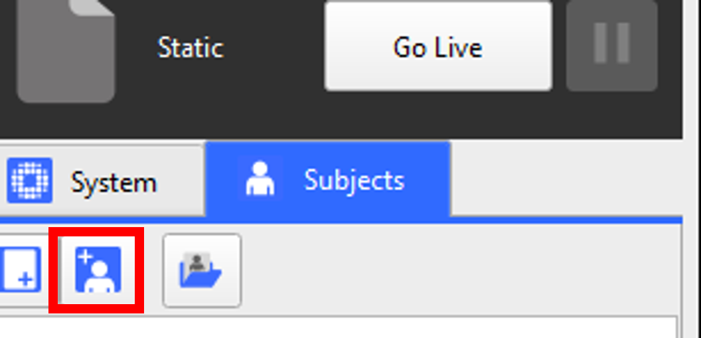
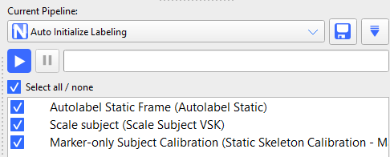

# Using an existing VST

[Watch the YouTube video](https://www.youtube.com/watch?v=yLwKPWTrPjU&list=PLxtdgDam3USUSIeuO6UloG3ogPsFNtEJS&index=26)

## 1. Select the VST

In **Resources**, click **Create a new subject from a labelling skeleton** and select the template you want to use.

<figure>

</figure>

## 2. Apply the model to the new subject

Go to **Tools** > **Pipeline** > **Current Pipeline**, then select **Auto Initialize Labeling**. Right-click and choose **Run Selected Operation** for each step, one at a time.

- **Autolabel** = automatic marker labeling. **Carefully check that all markers have been correctly labeled after this step.** Correct them manually if necessary.

- **Scale** = scales the model to match the subject's anthropometric dimensions.

- **Marker-only calibration**

Add **Update Skeleton Parameters** so that the model takes the new subject into account and improves its performance for future subjects.

<figure>

</figure>

Once the static trial has been processed, proceed with the dynamic trials and refer to the section [Dynamic trial processing](traitement_marches.md).