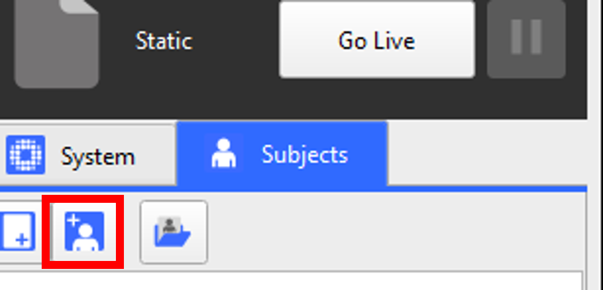
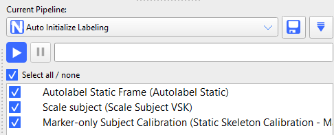

# Utiliser un VST existant

[Voir la vidéo YouTube](https://www.youtube.com/watch?v=yLwKPWTrPjU&list=PLxtdgDam3USUSIeuO6UloG3ogPsFNtEJS&index=26)

## 1. Choisir le VST

Dans **Ressources**, **create a new subject from a labelling skeleton**. Choisir le template à utiliser.

<figure>

</figure>

## 2. Appliquer le modèle au nouveau sujet

Dans **Tools** > **Pipeline** > **Current pipeline**, sélectionner **auto initialize labeling**. Clic droit + **run selected operation** à faire ligne par ligne

- Autolabel = labellisation automatique, **bien vérifier que les marqueurs sont ok après cette étape**. Corriger manuellement si besoin

- Scale = mise à l’échelle du sujet

- Marker-only calibration

Ajouter **Update skeleton parameters** pour que le modèle prenne en compte le nouveau sujet et s'améliore pour les suivants.

<figure>

</figure>

Une fois la statique enregistrée, passer aux enregistrements dynamiques et se référer au point [Traitement des enregistrements dynamiques](traitement_marches.md)